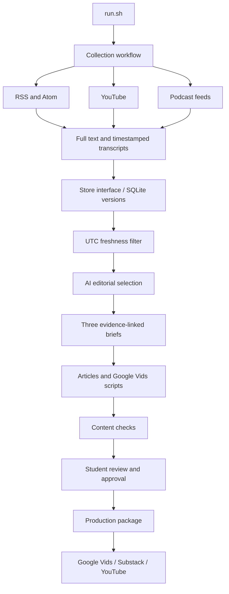

# Problem Set 4 — Research Loop

**Student:** Weibing Wang
**GitHub repository:** https://github.com/Wuhubing/ps04-research-loop

## Topic and Audience

- **Publication:** Research Loop
- **Topic:** Autonomous research agents, experimental automation and trustworthy results.
- **Audience:** Student researchers with basic programming knowledge.
- **Central question:** Which research tasks can we delegate to agents, and what evidence makes their results trustworthy?
- **Scope:** Computational experiments, evaluation and reproducibility; autonomous physical labs provide a contrasting case. Exclude generic AI news, speculative AGI timelines and investment advice.
- **Reason to return:** New methods and failure reports can change how readers design their next experiment.

## Published Series

| Piece | Editorial purpose | Substack | YouTube |
|---|---|---|---|
| 01 | What research work is actually automated? | [Free article 01](https://researchloopweibing.substack.com/p/research-loop-delegate-the-experiment) | [Unlisted video 01](https://youtu.be/GpkQYzDhcTs) |
| 02 | When can an improved metric mislead us? | [Free article 02](https://researchloopweibing.substack.com/p/research-loop-a-better-score-is-only) | [Unlisted video 02](https://youtu.be/dYsUBNhOEtA) |
| 03 | How should students run a trustworthy experiment? | [Free article 03](https://researchloopweibing.substack.com/p/research-loop-build-an-experiment) | [Unlisted video 03](https://youtu.be/l2P54o1BgG8) |

**Substack publication update:** The student explicitly authorized publishing the three current articles free and adding reciprocal video links. All three were published under Weibing Wang / @researchloopweibing with audience **Everyone**, no paywall, and web-only delivery (email/app sending disabled). The reader-facing pages contain full articles, reference links, AI-assistance disclosures and the correct accompanying YouTube links. All three YouTube descriptions now contain their corresponding free article URLs; Studio confirmed saves. Channel verification is still required for YouTube external URLs to be clickable, so they are presently supplied as full copyable URLs. The [publication manifest](runs/20261016T183853-editorial-v3/substack_publication/manifest.json) retains URLs and hashes; original evidence-linked article files remain intact. Only internal claim comments and the pending-video placeholder were removed/replaced, with an AI disclosure appended. The assistant initially verified the Everyone setting and full reader pages; its unauthenticated fetch was inconclusive. The student subsequently confirmed signed-out access. Original-source listening and technical-demo review are now student-confirmed, and GitHub delivery is complete.

**YouTube publication update:** The student stated (English translation), “I listened and found no issues. Please publish all three videos to YouTube as unlisted.” All three reviewed MP4s were uploaded manually by the student and then configured and published through YouTube Studio. The Content page explicitly confirms **Unlisted** for all three, with titles, source URLs/locators, evidence limitations, AI narration disclosure, not-made-for-kids audience settings, and AI-use disclosure. The videos retain their embedded review-copy footer; the authorized file bytes were not changed. See [publication links](runs/20261016T183853-editorial-v3/publication_links.json), [metadata](runs/20261016T183853-editorial-v3/youtube_upload_metadata.json), and [student authorization tied to file hashes](runs/20261016T183853-editorial-v3/video_publication_authorization.json). The student subsequently confirmed signed-out access to all three article/video pairs; see the final confirmation record. Studio says external links need channel verification to become clickable; the full source URLs are included as text. The later Substack authorization and publication record above completes article publication and reciprocal links. Video listening approval does not assert original-source listening.

**Technical demonstration:** [Download the separate 5:19 narrated walkthrough](https://github.com/Wuhubing/ps04-research-loop/releases/download/delivery-20261016/Research-Loop-Technical-Demo.mp4). Actual saved artifacts and storage replay are presented in six readable panels. AI narration uses the authorized local voice; this is not a live screen recording. Full decode and visual checks pass; automatic speech comparisons are retained, and student playback and understanding are now confirmed. See [production record](runs/20261016T183853-editorial-v3/technical_demo.json), [narration](docs/demo/narration.md), and [seven-day delivery schedule](docs/DELIVERY_SCHEDULE.md).

**Video 01 review render:** [Local MP4](data/media/video-01/Research-Loop-01-review.mp4) (1920×1080, H.264/AAC, 244.32 seconds), [English SRT](data/media/video-01/narration.srt), and [production record](runs/20261016T183853-editorial-v3/video_01_production.json). Six visual scenes were authored and exported from [Google Vids](https://docs.google.com/videos/d/1eCQAQ4mGpTYpsBOn6LY0gn-HgwREedWCZQiLjhrA7EA/edit). After approving a louder normal-speed clone preview, the student authorized all six narrations and video finishing. Qwen3-TTS generated the student's authorized voice locally; FFmpeg added 12 dB gain with a peak limiter, aligned scene durations and burned English captions. The reference recording was not uploaded. The student uploaded the combined MP4 into a separate [Google Vids narrated review copy](https://docs.google.com/videos/d/1kfNQMx0PKDRiKU4uKZKiBQrBjMZnnfwuhjElAEtij_8/edit), with a visible timeline duration of 04:04.3. It contains one rendered clip with baked-in subtitles; the original six-scene editable visual draft is preserved. Cloud processing completed; playback advanced in the Google Vids preview with picture and baked-in captions visible. The local review copy is complete and decodes successfully; this is explicitly a Google Vids visual production with local audio/caption finishing, not an entirely Vids-rendered final. The student subsequently approved the finished video after listening and authorized publication. Original-source listening was subsequently confirmed by the student.

**Videos 02 and 03 review renders:** [Video 02 MP4](data/media/video-02/Research-Loop-02-review.mp4) (269.79 seconds) and [Video 03 MP4](data/media/video-03/Research-Loop-03-review.mp4) (261.49 seconds), each with seven scenes, 1080p H.264/AAC and burned English captions. They use the same authorized local voice model, normal speed, 12 dB gain with limiter, and yellow/black numbered-card style as video 01. Their cards were drawn locally with Pillow and assembled with FFmpeg; they are not claimed as Google Vids-authored visuals. Complete decode checks pass; all scenes have retained automatic transcription comparisons and visual previews. Two scenes in video 02 were regenerated to improve pronunciation. The student subsequently approved the finished videos after listening; original-source verification was subsequently confirmed by the student. The two complete MP4s are also in Downloads. The student manually uploaded both complete MP4s after the extension upload failed. Both Google Vids documents show Saved to Drive and one rendered clip with baked captions: [video 02](https://docs.google.com/videos/d/1noV01ekaTxyZb6W3bjNrZTVEa78lLeasugffbziEey4/edit), timeline 04:29.8; [video 03](https://docs.google.com/videos/d/1PD3OuZ9IQF31W65O9KVuQAsgdTkYJXt_WOmMhbhnxik/edit), timeline 04:21.5. Cloud previews advanced to 00:10 and 00:12 respectively, with picture and English captions visible. This confirms cloud visual playback, not full human listening or editorial approval. See [production 02](runs/20261016T183853-editorial-v3/video_02_production.json) and [production 03](runs/20261016T183853-editorial-v3/video_03_production.json). No raw voice recording was uploaded; no API fee was incurred for local speech generation; machine cost remains unknown.

## Setup and Execution

See [operations](docs/OPERATIONS.md) and requirements.lock.txt. Run `bash setup.sh`, then `bash run.sh`; after genuine student review, run `bash run.sh --package runs/RUN_ID`. Codex CLI reuses the user's ChatGPT login. Model defaults are inherited and actual available metadata is retained in per-call event logs. No secret values belong in this repository.

## Architecture and Manual Handoffs

Bash coordinates independently runnable stages. Python handles extraction and validation; Codex makes editorial decisions and drafts from saved evidence. Only data/store.sh directly accesses the evidence database. Publication and video production remain manual handoffs, not claimed automation.

## Evidence and Runs

Run directories contain the actual date, configuration, source records, decisions, prompts, model responses, reviews and receipts. Assets are retained under data/assets; downloaded media under data/media is excluded from Git. Recover media from each candidate's original URL/media_url with the extraction component. No fictional starter examples count toward coverage.

Evidence collection: [20261014T032814-a43e45](runs/20261014T032814-a43e45/summary.json). [Collected sources](runs/20261014T032814-a43e45/source_inventory.md). Seventeen items were retained; fifteen remain eligible on October 14 UTC after excluding an old article whose feed date had been refreshed and a March article. Coverage is eleven written items, two YouTube videos and two podcasts, grouped into eleven conservative evidence origins. Native arXiv feed discovery remains incomplete after HTTP 429 responses; six primary-page recoveries are explicitly supplemental. Five eligible written items were actually discovered through syndication. Both podcasts share one Periodic Labs evidence-origin group.

The initial generated series exposed a wrong narrative window date and a possible automatic-transcription negation error. Those outputs remain preserved for inspection. The [editorial revision](runs/20261014T035037-editorial-v2/summary.json) reuses the same real evidence, applies policy v2 and regenerates the briefs and drafts. It is not another live collection. That first-date revision uses September 15–October 14, 2026. The latest v3 drafts below retain the second live run’s September 16–October 15 window for a controlled editorial comparison. Their actual revision began October 16; this is not a third live collection.

| Piece | Latest article draft | Latest Google Vids script |
|---|---|---|
| 01 | [Delegate the experiment loop, keep the scientific judgment](runs/20261016T183853-editorial-v3/articles/01.md) | [Script 01](runs/20261016T183853-editorial-v3/video_scripts/01.md) |
| 02 | [A better score is only the beginning](runs/20261016T183853-editorial-v3/articles/02.md) | [Script 02](runs/20261016T183853-editorial-v3/video_scripts/02.md) |
| 03 | [Build an experiment another person can check](runs/20261016T183853-editorial-v3/articles/03.md) | [Script 03](runs/20261016T183853-editorial-v3/video_scripts/03.md) |

Each script includes narration/subtitle text, visual directions and sources. The evidence-linked script files are preserved, and all three accompanying videos and articles have been published as documented above. See the [claim-to-source review cards](runs/20261016T183853-editorial-v3/evidence_review.md).

The latest [mechanical review](runs/20261016T183853-editorial-v3/review.json) passes, with the subsequent human listening and review confirmation recorded separately. Article word counts excluding references and hidden claim markers are 733, 745 and 730; narration counts are 529, 560 and 547, suitable for approximately 3–5 minutes depending on delivery and editing. These word-based estimates are distinct from the measured local video durations reported above.

The [second real live run](runs/20261015T003111-ebae97/summary.json) started October 15 at 00:31:11 UTC and completed end to end with exit 0 and passing mechanical review. Its window is September 16–October 15 inclusive. All three collectors succeeded, including the formerly rate-limited native arXiv feeds. Twenty-six observations produced 25 distinct retained items: eight newly collected items, seventeen unchanged items and no changed content versions. One duplicate solar-paper observation was merged. Twenty-three items are eligible (18 written, two YouTube, three podcasts), with 18 accepts, three rejects and two deferrals. The previous fifteen eligible items remain eligible and unchanged.

Seven newly collected papers came from restored feed discovery; a verified Campus Talks podcast was added explicitly to configuration. All eight predate the first run: this is expanded coverage, not eight new publications between runs. Native episode publication is September 23 at 23:01 UTC, earlier than its October 5 redistribution page. The podcast adds a researcher perspective, not independent experimental replication. See the [detailed comparison](runs/20261015T003111-ebae97/run_comparison.md), [source inventory](runs/20261015T003111-ebae97/source_inventory.md), [collection comparison](runs/20261015T003111-ebae97/comparison_collection.json) and [editorial comparison](runs/20261015T003111-ebae97/comparison_editorial.json).

The October 15 series cited thirteen sources, including three newly collected ones; five accepted items are not cited. [Actual source use](runs/20261015T003111-ebae97/source_usage.json) distinguishes selection suggestions from article/claim assignments. An unchanged practitioner article switched from reject to accept as an operational tutorial; this is an editorial judgment difference requiring student assessment, not a source update. The second-date v2 rules retain their substance; a heading/authorization-note wording cleanup is not claimed as a new student policy revision.

The earlier labeled storage replay verified seventeen unchanged records; it is supplementary and was not substituted for this second live run. No artificial content change or withheld replay was needed to manufacture a second-run difference. The one-time scheduled follow-up has now actually executed; there is no pending second-run scheduling requirement.

The expanded corpus required validated evidence extraction before synthesis. Full sources are retained; eighteen quote/segment cards passed exact matching and source-version checks. This introduces excerpt-selection risk, documented in [operations](docs/OPERATIONS.md), rather than silently truncating evidence. Eleven isolated [contract tests](runs/20261015T003111-ebae97/test-results.txt) pass, including the original ten checks plus rejection of invented evidence-card passages. Tests and mechanical matches do not substitute for human interpretation or listening.

Codex uses the ChatGPT subscription. Calls retain prompts, schemas, responses, events and available token usage under model_calls/. Later invocations explicitly pin and record the local configured model, gpt-6-astra; earlier calls retain their default-provider invocation and logs without claiming an independently verified model identifier. Dollar cost is unknown, not free. Local small.en transcription and FFmpeg consume machine resources; no dollar estimate has been measured.

## Editorial Review

Policy: config/editorial_policy.md. Prompts: prompts/. The user agreed to the proposed tutorial-as-demonstration direction. The [revision record and before/after differences](runs/20261014T035037-editorial-v2/policy_revision.md) preserve an actual media-selection rerun and regenerated synthesis. Tutorial acceptance remains bounded to procedures; it does not validate performance gains. Ambiguous automatic-transcript passages cannot justify accusations against a speaker without listening.

The student completed three accepted and three rejected case comparisons in chat; their verbatim responses and stated limits are preserved in the [completed six-case worksheet](runs/20261015T003111-ebae97/student_review.md). These judgments motivated policy v3, including human review of AI-judge conclusions, explicit author attribution and human-role disclosure, disclosure of unresolved numerical inconsistencies, separate review of original reports, and topic relevance. An [editorial-only rerun](runs/20261016T183853-editorial-v3/policy_revision.md) completed with exit 0 and passing mechanical checks using the frozen October 15 evidence window. The student later explicitly authorized publication of the current videos and articles, as recorded above. Original-source listening is now student-confirmed, and formal packaging is complete. The course starter remains the origin remote; the separate public student repository is available through the submission remote.

### Student-driven v3 outcome

The [v3 revision report](runs/20261016T183853-editorial-v3/policy_revision.md) records the six student judgments, policy changes, actual rerun and draft effects. All 23 evidence versions remain unchanged. Selection is 19 accepts, three rejects and one deferral; the six reviewed verdicts remain unchanged. Fork-and-Flush changes to method-only acceptance with explicit caveats, an AI extension not individually reviewed by the student. It is not cited in the new series. The latest drafts cite 9 sources; see [actual usage](runs/20261016T183853-editorial-v3/source_usage.json). Model variability may also affect the comparison.

The student's human-review safeguard now appears in article 03 and its matching narration. Author attribution and human involvement remain explicit; unresolved numerical inconsistency is disclosed where used. [All six draft differences](runs/20261016T183853-editorial-v3/draft_differences) are preserved. [Final review checklist](runs/20261016T183853-editorial-v3/final_review_checklist.md) links sixteen local source excerpts with context (approximately 14.9 minutes total); the student has confirmed completion of those checks in the final confirmation record. Publication authorization and original-source verification remain distinct records.

## Reflection

Implementation observation: a frozen evaluator can prevent edits to scoring code while still rewarding an undesirable outcome. Connecting the protein proxy mismatch with the production clustering failure yields a useful student question: what would an impressive score paired with an unusable result look like?

Editorial failure: the first generation treated a suspicious automatic-transcript phrase as a genuine contradiction. Exact string matches were insufficient; the revised policy defers that attribution until the recording is checked. A separate date error showed why the as-of header alone cannot validate a narrative window.

Architectural tradeoff: explicit component boundaries and immutable source references make claims inspectable at the cost of more artifacts and orchestration. The second run adds researcher audio through Campus Talks, while external replication evidence remains a priority. The two founder interviews still cannot independently validate one another, and researcher advice does not replicate the computational findings. The verified podcast and its native date are documented in docs/SOURCE_AUDIT.md. Student reflection (English translation of the actual chat response): “I think we could search the literature at a larger scale and explore cross-domain insights.” This is a future improvement, not a claim that broader coverage or cross-domain validation has already been implemented.

## Final delivery audit

A matching [approval record](runs/20261016T183853-editorial-v3/approval.json) transcribes the student’s actual publication authorization, with its original timestamp and scope. It does not attest original-source listening. The [formal package](runs/20261016T183853-editorial-v3/package/manifest.json) was generated without recollecting evidence or modifying articles/scripts; its publication-links array contains the real URLs. All 11 contract tests pass again after correcting stale delivery-status reporting.

An additional [storage-only replay](runs/replay-c48d0475956e) imported 26 observations: zero new, zero changed, 26 unchanged. It is explicitly not a live collection. Prior submission wording is retained under docs/history.

Final verification: the student explicitly confirmed original-source listening, signed-out access to all article/video pairs, and playback and understanding of the technical demo. These are student attestations, not newly performed assistant checks. YouTube channel verification for clickable external links remains an optional platform improvement; full URLs are already supplied. Videos 02/03 were locally authored, imported and exported through Google Vids; the hybrid workflow is disclosed rather than described as all-Vids authoring.

Google Vids additionally rendered and exported both imported videos to Drive during the final audit: [02 export](https://drive.google.com/file/d/1ZAXMH1M5JanD8zgMHkV1uZ7gSZQbVAps/view), [03 export](https://drive.google.com/file/d/1_B5yH92liick50my-uNEL--MqDDupSKf/view). The UI confirmed “Export complete” for each. These Drive files retain account access restrictions; the public deliverables remain the existing YouTube URLs. The graphics were still authored locally, and no published approved video was replaced.

Final audit: [requirement-by-requirement checklist](docs/REQUIREMENTS_AUDIT.md). Public repository push is verified; the starter remote is preserved as origin and the student repository uses submission. Raw voice samples and downloaded source media are excluded.

## Final student confirmation

The student confirmed all three final checks in chat: original-source audio quotations, technical-demo playback and understanding, and signed-out access to the three article/video pairs. See [the dated confirmation record](runs/20261016T183853-editorial-v3/final_student_confirmation.json). The English translation preserves the meaning of the actual confirmation; it does not invent individual listening notes. Historical logs and original student responses are retained as audit evidence, while this submission document is entirely in English. The technical-demo video accurately reflects the pending state at recording time; this later confirmation supersedes that status.
